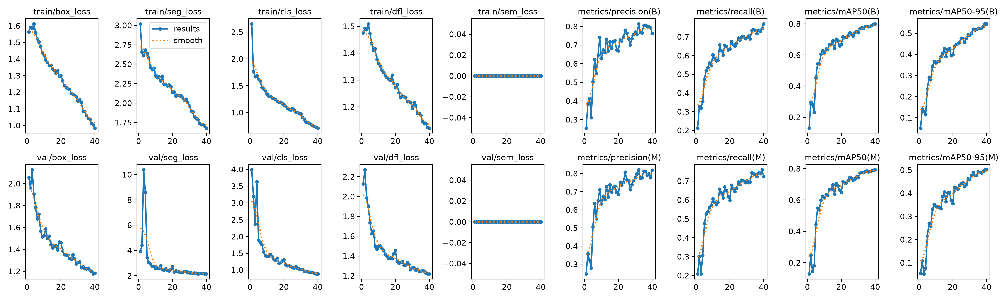
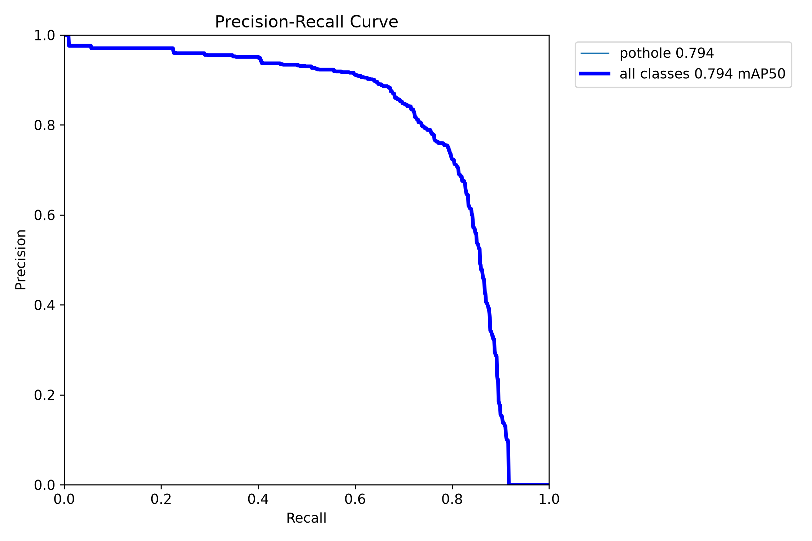
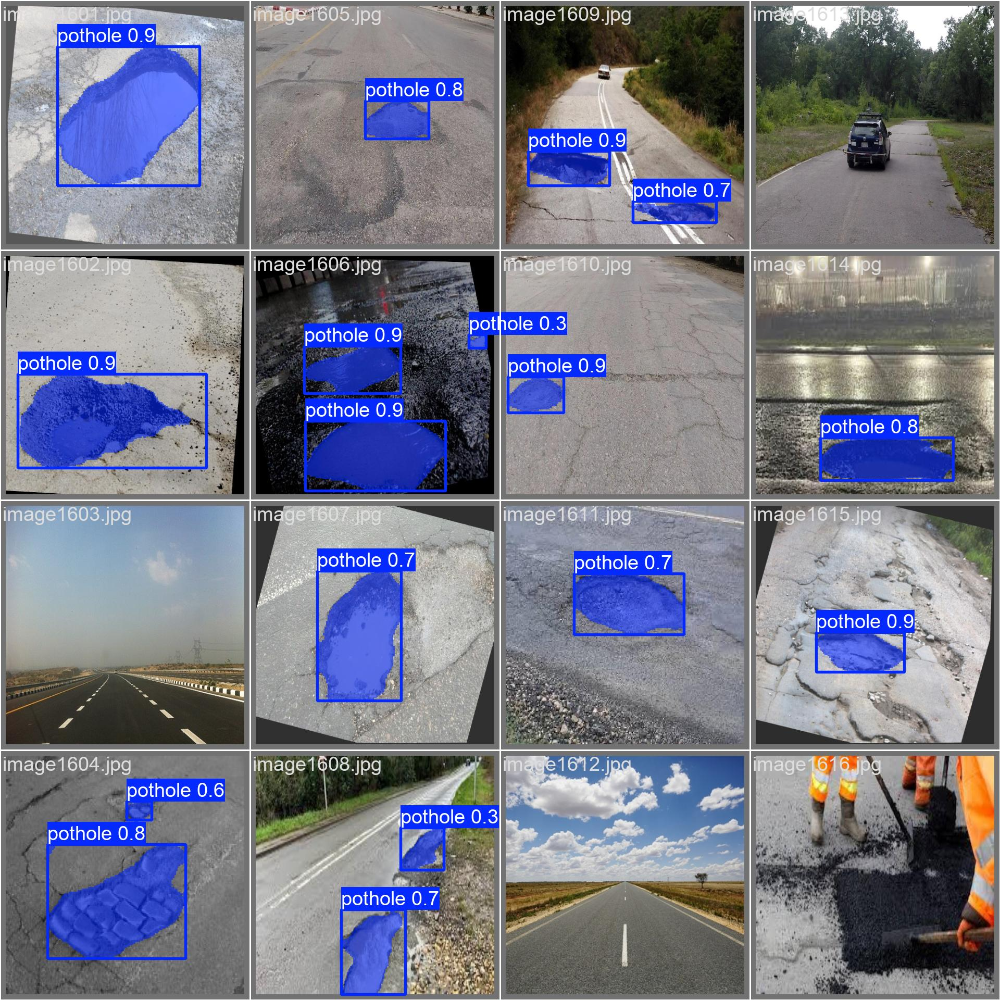

# SIH26124: Edge AI Road Hazard Detection & Municipal Command System

An automated, real-time **Edge AI road-auditing platform** that turns city transit buses (modeled on **Jaipur JCTSL** corridors) into mobile infrastructure sensors. A windshield-mounted camera runs **YOLOv8 Instance Segmentation** and **DeepSORT** tracking directly on low-power edge silicon, calculates perspective-adjusted pothole severity, deduplicates repeat sightings within a **5-meter Haversine GPS radius**, and sends compact JSON alerts to a **Jaipur Smart City ICCC** command map.

## System Architecture

```text
[Bus Dashcam] -> [YOLOv8n-Seg (OpenVINO / CUDA)] -> [DeepSORT Tracker (n_init=3)]
                                                              |
[Jaipur ICCC Map] <- [5m Haversine Geo-Dedup] <- [46.5 KB JSON + Peak Crop]
```

* **99.97% Cellular Data Savings:** Replaces continuous 1080p fleet video uploads (~117.9 TiB/month modeled across 200 buses) with compact JSON alerts and cropped JPEG evidence (~39.91 GiB/month).
* **Perspective-Adjusted Severity:** Weights pothole mask area by vertical road position (`1.5 - 0.5 * (y_c / H)`) so distant craters near the horizon are scored accurately (`MINOR`, `MODERATE`, `CRITICAL`).
* **Two-Layer Deduplication:** DeepSORT prevents single-pass frame duplicates, while 5-meter Haversine clustering merges repeat bus passes.

## Custom Model Performance (Trained on RTX 5060 Ti 16 GB)

Fine-tuned `yolov8n-seg` for 40 epochs at `640x640` (`batch=32`) on 1,986 polygon-annotated pothole images:

| Metric | Bounding Box (B) | Segmentation Mask (M) |
| :--- | :---: | :---: |
| **mAP@50** | **0.800** | **0.794** |
| **mAP@50-95** | **~0.55** | **~0.50** |
| **Precision** | **~0.80** | **~0.82** |
| **Recall** | **~0.77** | **~0.74** |



| Mask Precision-Recall Curve (0.794 mAP50) | Validation Predictions (Zero False Alarms on Clean Roads) |
| :---: | :---: |
|  |  |

## Measured Hardware Benchmarks (640x640, Batch=1)

| Accelerator | Runtime / Precision | Inference Latency | Throughput |
| :--- | :--- | :---: | :---: |
| **Intel Arc iGPU (`xpu`)** | OpenVINO FP16 IR | **8.99 ms/frame** | **111.2 FPS** |
| **NVIDIA RTX 5060 Ti 16GB (`cuda:0`)** | PyTorch CUDA 12.8 | **11.18 ms/frame** | **89.5 FPS** |
| **Intel Core Ultra 7 NPU (`npu`)** | OpenVINO FP16 IR | **13.66 ms/frame** | **73.2 FPS** |
| **Intel Core Ultra 7 CPU (`cpu`)** | OpenVINO FP16 IR | **17.97-20.84 ms/frame** | **48.0-55.6 FPS** |

> On our stress-test waterlogged pothole clip (`sample_jaipur.mp4`), upgrading from the 90-image starter weights to our custom 1,986-image weights increased DeepSORT tracks from **12 to 42** and verified map hazards from **9 to 19** live on the Intel NPU.

## Setup Guide (For Teammates)

1. Clone the repo and create a virtual environment:
```bash
git clone [https://github.com/JGthegoat2708/SIH26124-Road-Hazard-AI.git](https://github.com/JGthegoat2708/SIH26124-Road-Hazard-AI.git)
cd SIH26124-Road-Hazard-AI
python -m venv .venv
.venv\Scripts\Activate.ps1
```

2. Install PyTorch for your laptop + shared requirements:
```bash
# NVIDIA RTX 50-Series GPU:
pip install torch torchvision --index-url [https://download.pytorch.org/whl/cu128](https://download.pytorch.org/whl/cu128)

# Intel Core Ultra (NPU/iGPU) or CPU-only laptop:
pip install torch torchvision --index-url [https://download.pytorch.org/whl/cpu](https://download.pytorch.org/whl/cpu)

# Shared packages:
pip install -r requirements.txt
```

3. Download `best.pt` and `sample_jaipur.mp4` from **Releases (`v1.0-weights`)** into `models/best.pt` and `data/videos/sample_jaipur.mp4`.

4. Export OpenVINO (Intel/CPU laptops) and run:
```bash
python scripts/export_openvino.py --weights models/best.pt --precision fp16 --imgsz 640
python -m src.pipeline --model models/best_fp16_openvino_model --source data/videos/sample_jaipur.mp4 --device npu
streamlit run dashboard/app.py
```